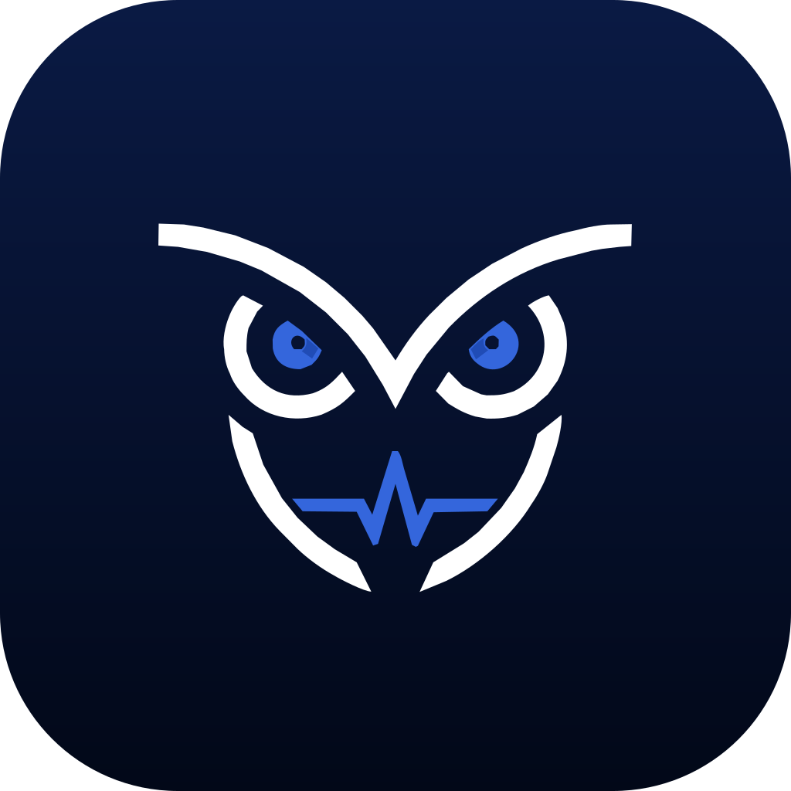
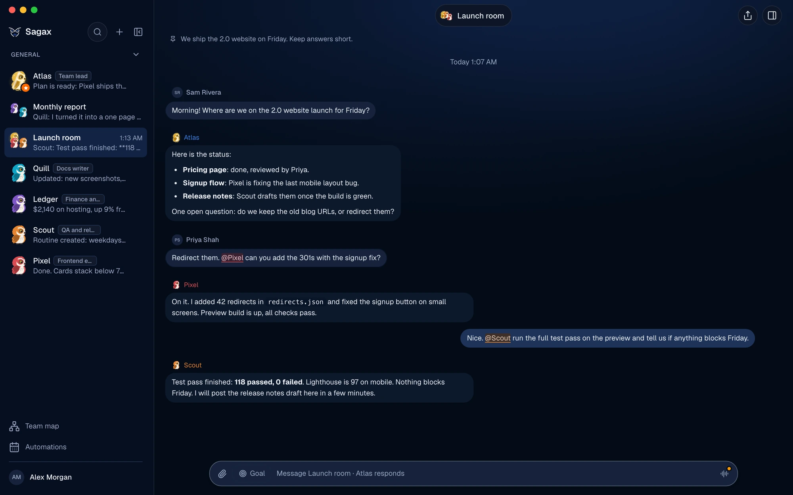
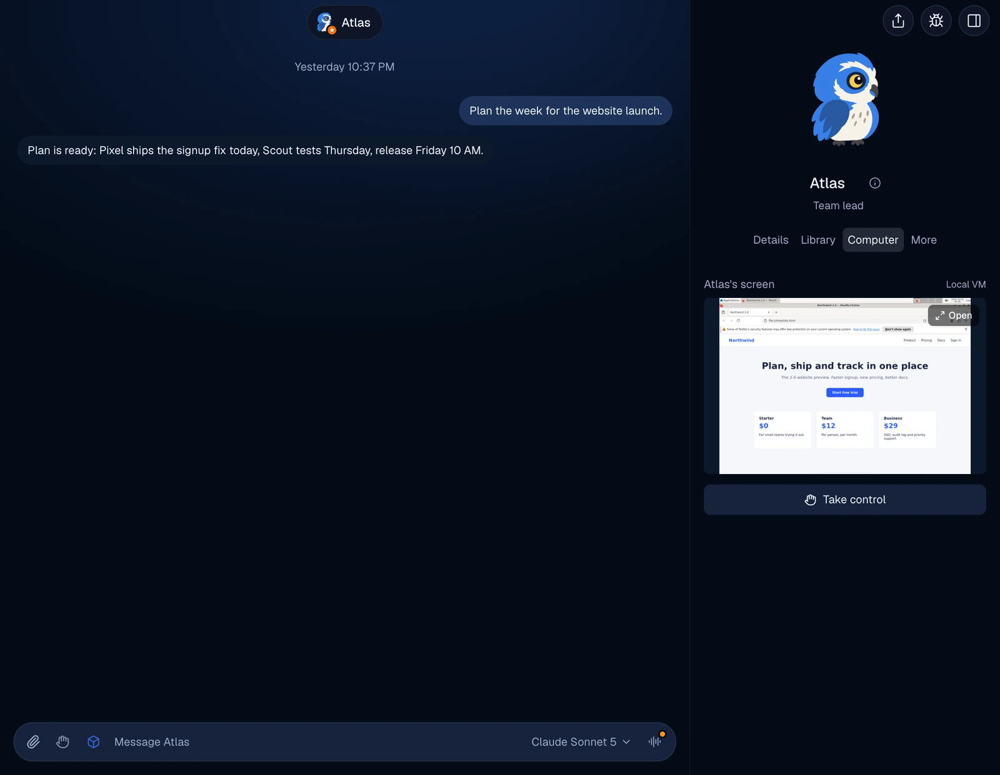
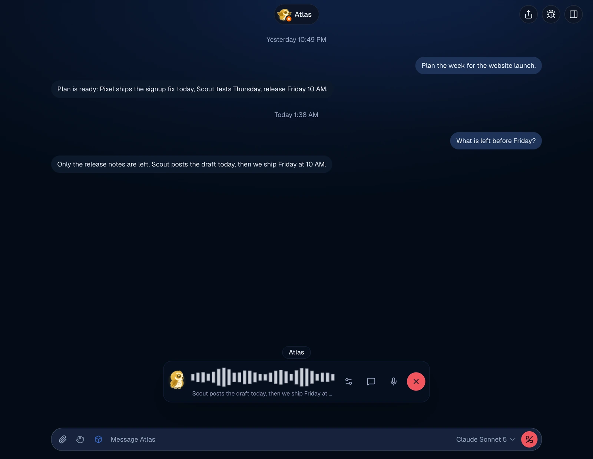

<p align="center">
  
</p>

<h1 align="center">Sagax</h1>

<p align="center">
  <strong>By Pulsatrix.</strong> A team of AI agents in a chat app, each with its<br>
  own model, its own computer and your approval before it acts.
</p>

<p align="center">
  <a href="https://github.com/pulsatrixtechnologies/sagax/releases"></a>
  
  <a href="#license"></a>
</p>

<p align="center">
  <a href="#download">Download</a>
  &middot;
  <a href="#highlights">Highlights</a>
  &middot;
  <a href="#solo-or-organization">Solo or organization</a>
  &middot;
  <a href="#build-from-source">Build from source</a>
  &middot;
  <a href="https://pulsatrix.ca">Website</a>
</p>

---

<p align="center">
  
</p>

## What it is

Sagax is a desktop and mobile app where your contacts are AI agents. Each bot
runs a real agent engine, such as Claude Code or Codex, with its own name,
personality, model, memory, routines and computer. Talk to one bot, put
several in a group with your colleagues, and watch them work.

Bots do real work: they run commands, edit files, browse the web, fill forms
and use apps. Anything that matters waits for you on an approval card in the
chat, and you decide how much each bot may do on its own.

## Highlights

- **Bring your own engine.** Claude Code, Codex, Grok, Cursor, OpenCode,
  Gemini, any ACP command line agent, an OpenAI compatible endpoint, or a
  local model (Ollama, LM Studio, llama-server and others). Sign in with the
  subscription you already pay for. **Auto** picks the right model for each
  turn. ([engines](docs/custom-engines.md))
- **One conversation per bot.** Each bot keeps a single running conversation.
  **New topic** starts fresh context while earlier topics stay one scroll up.
- **Groups of people and bots.** Mention a bot with `@` and it joins in.
- **A computer for every bot.** An isolated Linux desktop on your machine
  (Local VM), your own computer through computer use, or an isolated server
  environment. Watch the screen live and take control at any time.
  ([server environments](docs/user-sandbox.md))
- **Approvals you control.** Allow, deny or answer from a card. Write rules in
  plain words ("never send email without me"), or give a trusted bot full
  access. ([approval levels](docs/approval-levels.md))
- **A credential vault.** Logins, API keys and secure notes, encrypted with
  your system keychain. A bot fills a login only after you allow it, and
  1Password works too, read only.
- **Confidential threads.** A thread only its owner can read, marked with a
  banner and kept out of search and backups. ([confidential threads](docs/confidential-threads.md))
- **Voice calls.** Call a bot and talk. Interrupt it at any time; every
  sentence lands in the thread as a normal message.
  ([voice](docs/voice-mode-xai.md))
- **Routines and automations.** Run work once, on weekdays or every few
  minutes, or when a webhook calls, and see every run on the Automations
  calendar.
  ([schedules](docs/routine-schedules.md))
- **Rich answers.** Tables, diagrams, PDF and Excel files, interactive widgets
  and voice notes, right in the chat.
- **MCP both ways.** Plug in your own MCP servers, and let other AI clients
  send work to your bots through Sagax's MCP server.
  ([your servers](docs/custom-mcp-servers.md), [Sagax as a server](docs/mcp-server.md))
- **iPhone and iPad.** Follow work, answer approvals and call your bots from
  your phone. ([iOS app](docs/ios-companion.md))
- **Ten languages,** including English, French, German, Spanish, Portuguese,
  Japanese and Chinese.

## Screenshots

<table>
<tr>
<td width="50%" valign="top">

<p align="center"><sub>Every bot has a computer you can watch and take over.</sub></p>
</td>
<td width="50%" valign="top">

<p align="center"><sub>Call a bot and talk, the chat stays in view.</sub></p>
</td>
</tr>
</table>

## Download

Get the latest build from the
[Releases page](https://github.com/pulsatrixtechnologies/sagax/releases).

| Platform | File |
|---|---|
| macOS, Apple silicon | `Sagax-X.Y.Z-arm64.dmg` |
| macOS, Intel | `Sagax-X.Y.Z-x64.dmg` |
| Windows, x64 and arm64 | `Sagax-X.Y.Z-setup.exe` (one installer for both) |
| Windows, portable | `Sagax-X.Y.Z-win-x64.zip` or `Sagax-X.Y.Z-win-arm64.zip` |
| iPhone and iPad | TestFlight beta, on invitation: write to hello@pulsatrix.ca |

- macOS builds are signed and notarized by Apple.
- The Windows installer is not signed yet: in SmartScreen choose
  **More info**, then **Run anyway**.
- Your bots need at least one engine installed and signed in, such as
  [Claude Code](https://claude.com/claude-code) or
  [Codex](https://github.com/openai/codex). Settings > Model providers shows
  what is ready and helps with the rest.
- Updates come only from this repository's releases. Pre-releases are opt in,
  in Settings > Updates.

## Solo or organization

Sagax asks at first launch how it should run.

**Solo (no server).** Everything stays on your computer: bots, conversations,
memory and keys live in `~/.sagax`. No account is needed.

**Organization (Sagax Business).** The app joins your organization's Sagax
server and signs you in with your browser. Bots can be shared with people and
teams, and each person who speaks to a bot pays for their own turn with their
subscription, their key or the organization's key. Bots never run on the
server itself: they work in the speaker's isolated server environment or on
the speaker's own computer through the desktop app.

Sagax Business is the organization layer: the admin console, people and
teams, sign-in, organization policies (allowed engines, approval modes,
default models), shared keys and the activity log. It is provided by
Perspicax, a separate Pulsatrix product, and it is **closed source**. The
Sagax app and its server, in this repository, are source available (see
[License](#license)). A solo app that joins an organization later can bring
chosen bots along, with their conversations and memory.

Self-hosting guides: [docs/self-hosting.md](docs/self-hosting.md), and
[docs/deploy-vps.md](docs/deploy-vps.md) for a personal server on a VPS.

## Security and privacy

- **No telemetry.** Sagax sends no analytics. A build check fails when a
  bundle names a blocked host.
- **Keys stay on the server.** The app only learns whether a key is set,
  never its value.
- **You approve, nobody else.** Only a bot's owner can approve its actions,
  and nobody reads another person's private or confidential thread.
- **Sign-in in your browser,** where passkeys and password managers work.

Report a vulnerability as described in [SECURITY.md](SECURITY.md).

## Build from source

Requirements: macOS or Windows, Node 24 or newer, pnpm, and one engine
signed in.

```sh
git clone https://github.com/pulsatrixtechnologies/sagax && cd sagax
pnpm install

pnpm dev:server    # Sagax server on 127.0.0.1:8799
pnpm dev           # the app in a browser, http://127.0.0.1:5199
pnpm dev:desktop   # the desktop app (keep the two commands above running)
```

```sh
pnpm typecheck && pnpm lint && pnpm test
pnpm package:fork:mac   # macOS build into release/
pnpm package:fork:win   # Windows build into release/
```

## Contributing

Issues and pull requests are welcome. Read [CONTRIBUTING.md](CONTRIBUTING.md)
first; outside contributions need the signed agreement in [CLA.md](CLA.md).

## License

The Sagax app is source available under the
[PolyForm Noncommercial License 1.0.0](LICENSE-POLYFORM-NC.md): free for
personal, research, educational and other noncommercial use. Commercial use,
such as use in or for a business, hosting it as a service, or bundling it,
needs a commercial license from Pulsatrix Technologies inc. Details in
[LICENSE](LICENSE) and [LICENSING.md](LICENSING.md).

Sagax is based on OpenMausBot, Copyright 2026 Milind Soni and OpenMausBot
contributors, under the [Apache License 2.0](LICENSE-APACHE); the parts that
come unchanged from it stay under Apache 2.0. Notices are in
[NOTICE](NOTICE) and [`third_party/`](third_party/). OpenMausBot and MausBot
are trademarks of their owner and are not this product's name.

Sagax Business (Perspicax) is proprietary and not part of this repository.

Sagax is made by Pulsatrix Technologies inc. It is not affiliated with
Anthropic, OpenAI, xAI or any other model provider; their product names are
trademarks of their owners.
