<p align="center">
  
</p>

<h1 align="center">Sagax</h1>

<p align="center">
  <strong>Your AI teammates, in a chat app.</strong><br>
  Each bot has its own engine, its own computer and a mascot of its own.<br>
  Nothing that matters happens without your approval.
</p>

<p align="center">
  <a href="https://github.com/pulsatrixtechnologies/sagax/releases"></a>
  
  <a href="#license"></a>
</p>

<p align="center">
  <a href="#download">Download</a>
  &middot;
  <a href="#why-sagax">Why Sagax</a>
  &middot;
  <a href="#what-your-bots-can-do">Features</a>
  &middot;
  <a href="#a-server-of-your-own">Self-host</a>
  &middot;
  <a href="#documentation">Docs</a>
  &middot;
  <a href="https://pulsatrix.ca">Website</a>
</p>

---

<p align="center">
  <picture>
    <source media="(prefers-color-scheme: light)" srcset="docs/readme/hero-light.png">
    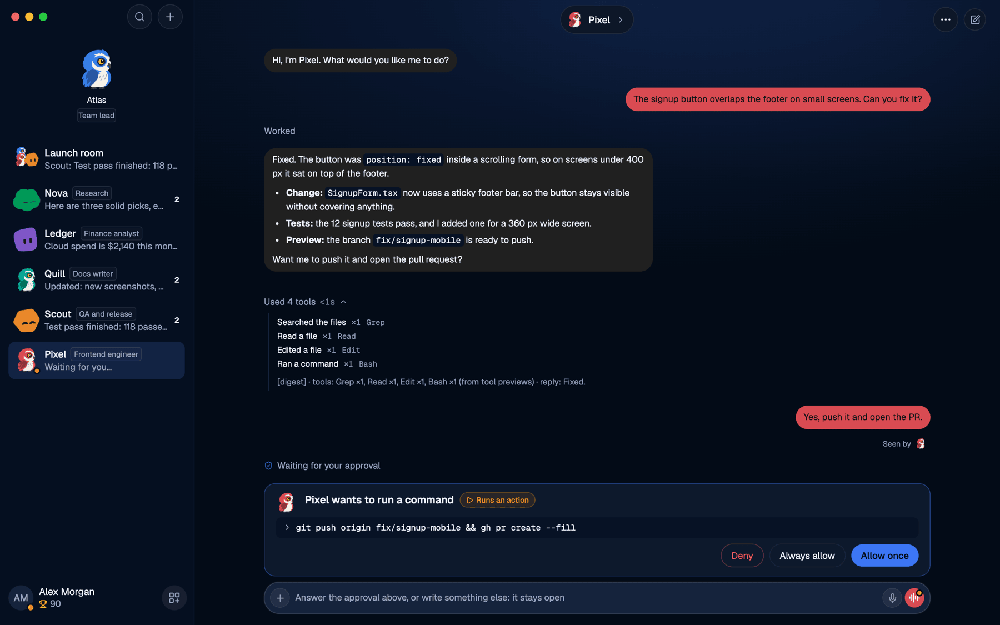
  </picture>
</p>

Sagax is a desktop and mobile app where your contacts are AI agents. Each
bot runs a real agent engine, such as Claude Code, Codex or Grok, with its
own name, personality, model, memory, routines and computer. Talk to one bot,
put several in a group with your colleagues, call one on the phone, and watch
them work.

Bots do real work: they run commands, edit files, browse the web, fill forms,
shop, publish pages and use apps. Anything that matters waits for you on an
approval card in the chat, and you decide how much each bot may do on its own.

## Why Sagax

- **Bring your own engine.** Claude Code, Codex, Grok, Cursor, OpenCode,
  Gemini, any ACP command line agent, an OpenAI compatible endpoint or a
  local model. Sign in with the subscription you already pay for.
- **Auto picks the model.** One brain per bot, and the right model per task:
  a short question runs on a fast model, code and long reads keep the main
  one, and workers get the best model for their job.
- **Your Grok and Claude connectors, in every bot.** Mail, calendar, Teams and
  the rest reach your bots through the account that has them. When a request
  needs a connector another engine holds, the turn moves there and the result
  comes back, with no copy of your sign-in.
- **A computer for every bot,** and a browser that works out of sight. The
  screen is used only when you ask, and it is always announced with a Stop
  button.
- **Approvals you control,** in plain words. Allow, deny or answer from a
  card; write rules such as "never send email without me"; give a trusted bot
  full access.
- **Yours, on your machine.** No account for solo use, no telemetry, a
  credential vault on your keychain, and conversations encrypted at rest.

## What your bots can do

### One conversation per bot, or several side by side

Each bot keeps a single running conversation; **New topic** starts fresh
context while earlier topics stay one scroll up. The composer stays free
while the bot works, a message sent mid-turn is taken into account, and
"wait" stops it right away. Drag a bot, a group or a thread onto the
conversation to open it beside the main chat.

<p align="center">
  <picture>
    <source media="(prefers-color-scheme: light)" srcset="docs/readme/split-view-light.png">
    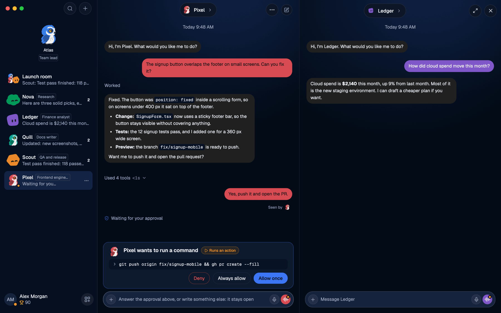
  </picture>
</p>

### Mascots, shapes and skins

Every bot wears a character: the owl, the crab, the Shapes, and the ones your
achievements unlock. Characters move while the bot thinks, works, waits or
sleeps, on the desktop, on your phone and in your notifications. Pick a
character, a shape, a color and a skin for each bot, and a skin for the app.
([mascots](docs/mascots.md), [achievements](docs/achievements.md))

<p align="center">
  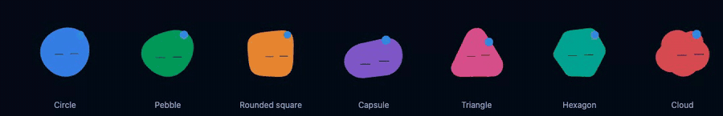
</p>

<p align="center">
  <picture>
    <source media="(prefers-color-scheme: light)" srcset="docs/readme/appearance-light.png">
    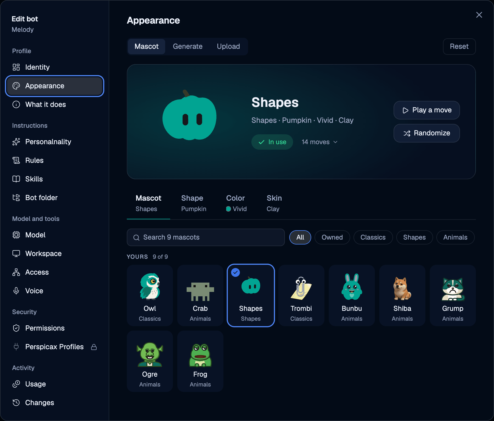
  </picture>
</p>

### Groups of people and bots

Mention a bot with `@` and it joins in. Give the group a goal and the bots
work toward it in the group's own conversation. A group can also hold people
only, and you can leave a group you were added to.

<p align="center">
  <picture>
    <source media="(prefers-color-scheme: light)" srcset="docs/readme/group-light.png">
    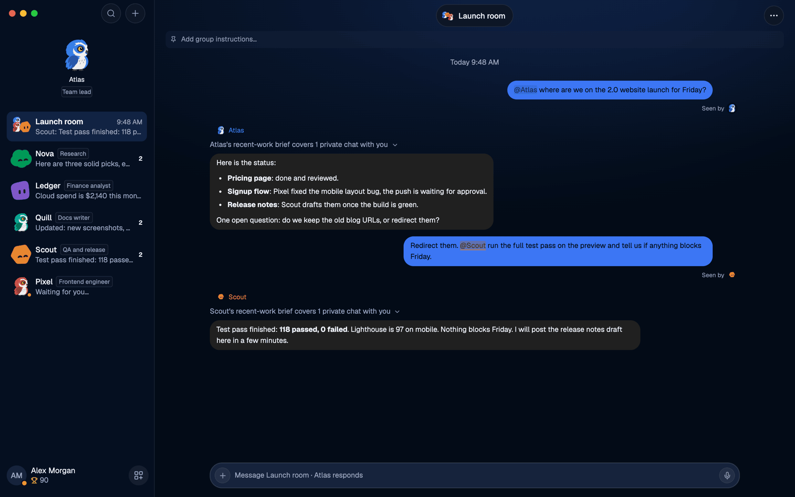
  </picture>
</p>

### Routines, the daily brief and your phone

Run work once, on weekdays, every few minutes, when a webhook or an email
arrives, or only when a file or a command's output changes. Sort routines
into folders; a routine that fails several times pauses itself. Every run
lands on the Automations calendar. A **daily brief** runs in the background
and reaches you where you are. With **Reach me**, a bot asks its questions
outside the app: push notification, text message, Teams or Telegram. With a
phone line, people can call your bot or text it, and a text becomes a turn of
your conversation. ([schedules](docs/routine-schedules.md),
[folders](docs/routine-folders.md), [Reach me](docs/reach-me.md))

<p align="center">
  <picture>
    <source media="(prefers-color-scheme: light)" srcset="docs/readme/automations-light.png">
    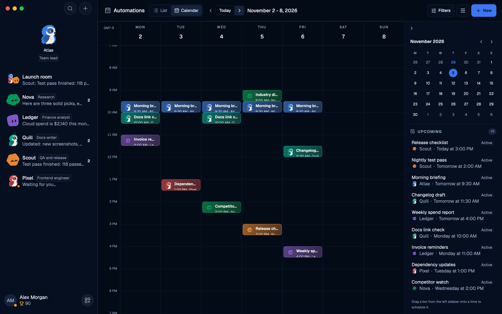
  </picture>
</p>

### Voice

Call a bot and talk. xAI does the listening and the speaking; the bot stays
the brain, with its tools, memory and approvals, and every sentence lands in
the thread as a normal message. Dictation and read-aloud work on the desktop
and on iOS. ([voice](docs/voice-mode-xai.md))

### Engines, models and connectors

Settings > Models shows what is signed in and what needs setup. **Auto model**
picks the model for each turn, by task. Connect Apps brings your Claude and
Grok connectors, MCP servers, plugins and skills to your bots, for everyone
or for one bot, and `run_with_engine` hands part of a task to another engine.
Other AI clients can send work to your bots through Sagax's own MCP server.
([engines](docs/custom-engines.md), [your MCP servers](docs/custom-mcp-servers.md),
[Sagax as an MCP server](docs/mcp-server.md))

<table>
<tr>
<td width="50%" valign="top">
<picture>
  <source media="(prefers-color-scheme: light)" srcset="docs/readme/models-light.png">
  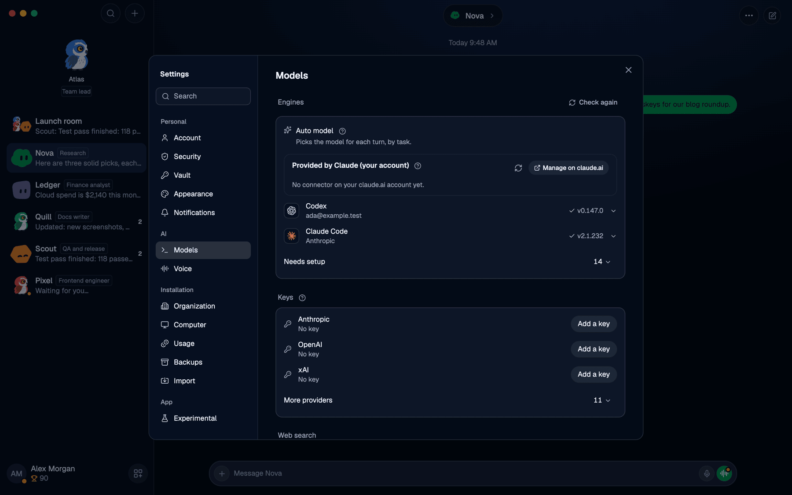
</picture>
<p align="center"><sub>Auto model, and the engines you already pay for.</sub></p>
</td>
<td width="50%" valign="top">
<picture>
  <source media="(prefers-color-scheme: light)" srcset="docs/readme/connect-apps-light.png">
  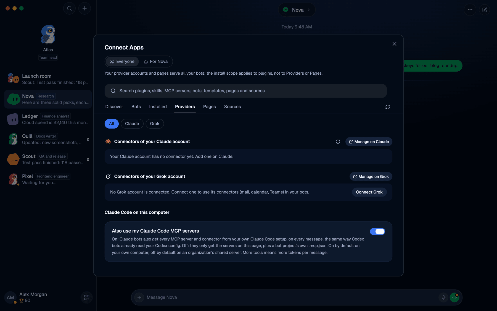
</picture>
<p align="center"><sub>Your Claude and Grok connectors, served to every bot.</sub></p>
</td>
</tr>
</table>

### Pages, published by your bots

A bot proposes a page in the conversation; you publish it or decline. A
published page opens with a reading bar, Share and Download PDF, and a public
link that needs no sign-in. Readers comment right in the page, in real time,
suggest edits on Markdown pages, and the bot reads the comments and answers
them. Files and artifacts live in each bot's Library, with earlier versions
kept.

<p align="center">
  <picture>
    <source media="(prefers-color-scheme: light)" srcset="docs/readme/page-light.png">
    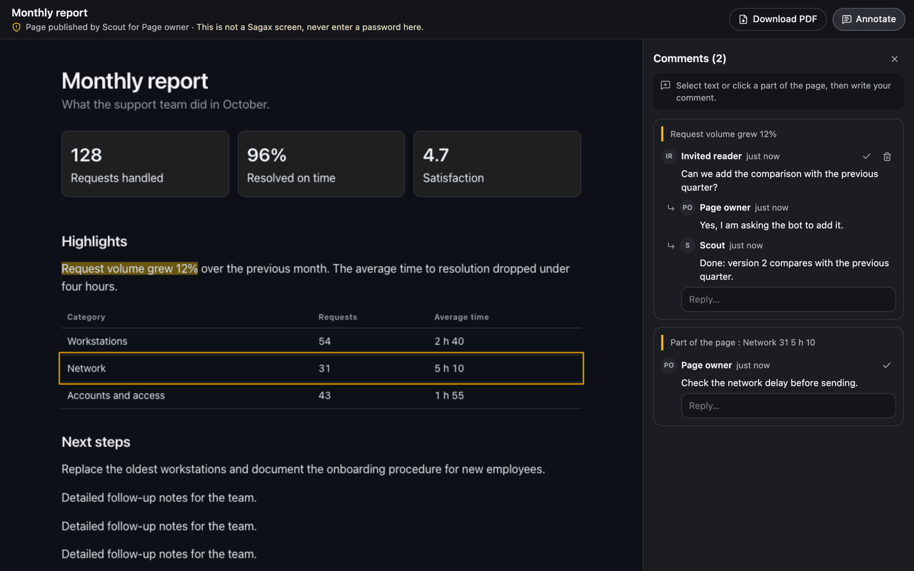
  </picture>
</p>

### Every bot gets a panel, a library and a computer

Open a bot's panel for its details, suggestions, coding branches, routines,
files and screen. A bot's computer is an isolated Linux desktop on your
machine (Local VM), your own computer through computer use, or an isolated
server environment. Watch the screen live and take control at any time.
Memory recalls by meaning, not only by words. ([computer use](docs/computer-use-integration.md),
[server environments](docs/user-sandbox.md), [memory](docs/memory.md))

<p align="center">
  <picture>
    <source media="(prefers-color-scheme: light)" srcset="docs/readme/bot-panel-light.png">
    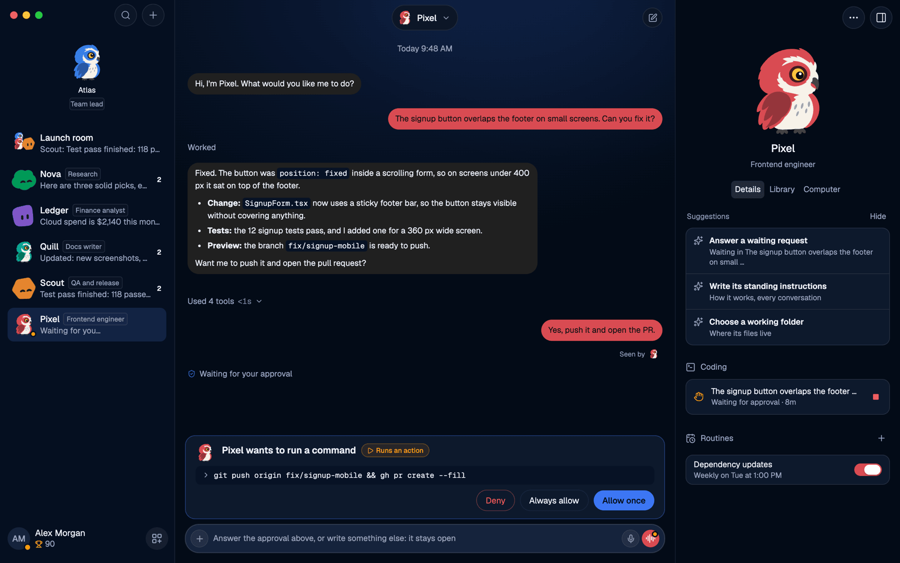
  </picture>
</p>

### Vault, shopping and cards

Logins, API keys and secure notes live in a vault on your system keychain;
1Password works too, read only. A bot fills a login only after you allow it,
for this turn only if you prefer, and a filled value never shows up in the
prompt or the logs. Bots shop with cards in the chat, follow up on orders,
and can pay with a one-time card from Shop Pay or Link. Phone calls and
purchases show up as cards with a result.

<table>
<tr>
<td width="50%" valign="top">
<picture>
  <source media="(prefers-color-scheme: light)" srcset="docs/readme/vault-card-light.png">
  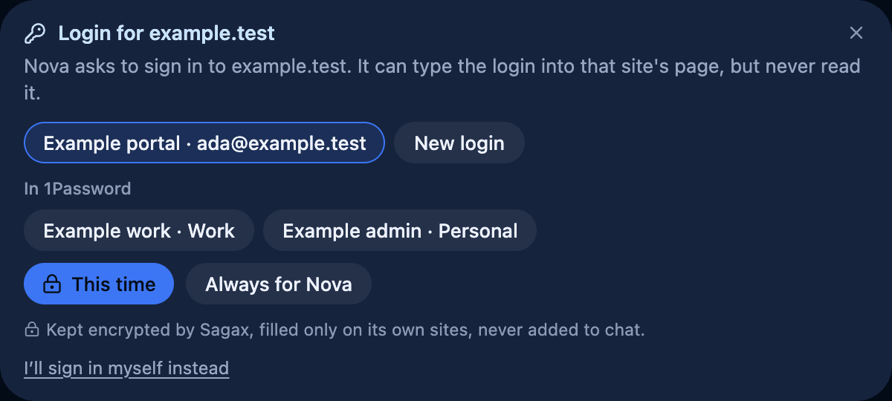
</picture>
<p align="center"><sub>A bot asks before it signs in anywhere.</sub></p>
</td>
<td width="50%" valign="top">
<picture>
  <source media="(prefers-color-scheme: light)" srcset="docs/readme/purchase-card-light.png">
  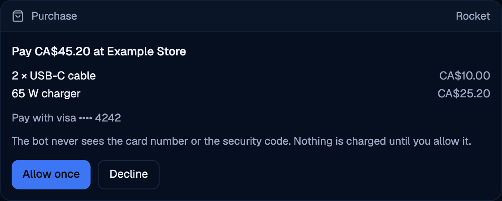
</picture>
<p align="center"><sub>Purchases wait on a card too.</sub></p>
</td>
</tr>
</table>

### iPhone, iPad and your watch

Follow work, answer approvals, call your bots and manage their routines from
your phone. Each bot keeps the same single conversation as on the desktop.
Notifications carry the bot's mascot, on the phone and on the watch.
([iOS app](docs/ios-companion.md))

<table>
<tr>
<td width="25%" valign="top">
<picture>
  <source media="(prefers-color-scheme: light)" srcset="docs/readme/ios-iphone-02-home-approval-light.png">
  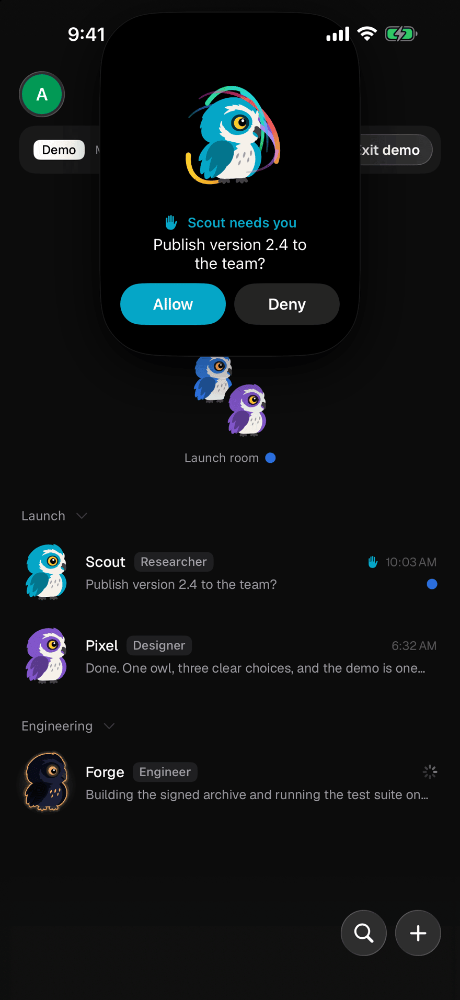
</picture>
</td>
<td width="25%" valign="top">
<picture>
  <source media="(prefers-color-scheme: light)" srcset="docs/readme/ios-iphone-03-chat-approval-light.png">
  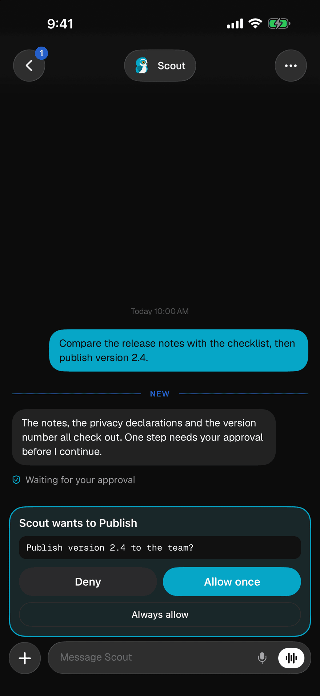
</picture>
</td>
<td width="25%" valign="top">
<picture>
  <source media="(prefers-color-scheme: light)" srcset="docs/readme/ios-iphone-04-chat-page-light.png">
  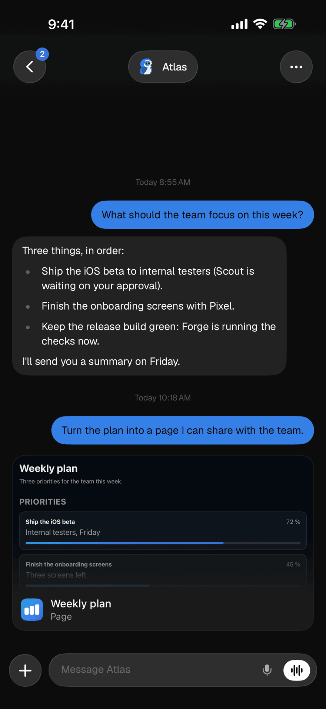
</picture>
</td>
<td width="25%" valign="top">
<picture>
  <source media="(prefers-color-scheme: light)" srcset="docs/readme/ios-iphone-05-bot-profile-light.png">
  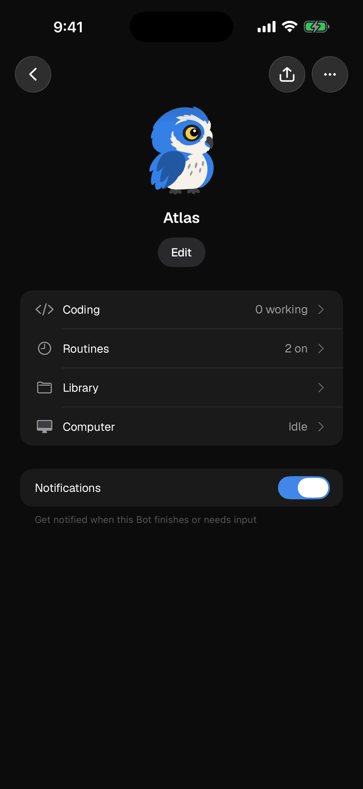
</picture>
</td>
</tr>
</table>

<table>
<tr>
<td width="50%" valign="top">
<picture>
  <source media="(prefers-color-scheme: light)" srcset="docs/readme/ios-ipad-01-chat-sidebar-light.png">
  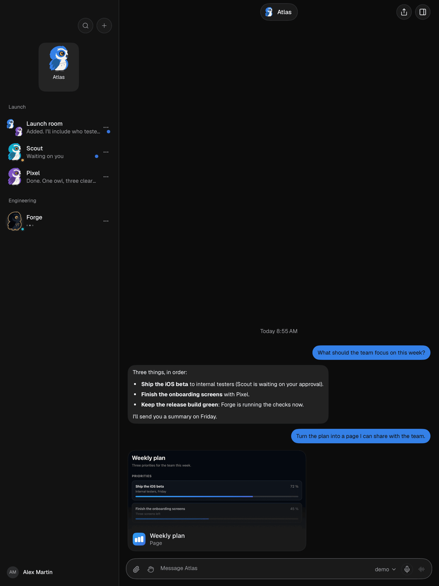
</picture>
</td>
<td width="50%" valign="top">
<picture>
  <source media="(prefers-color-scheme: light)" srcset="docs/readme/ios-ipad-02-chat-approval-light.png">
  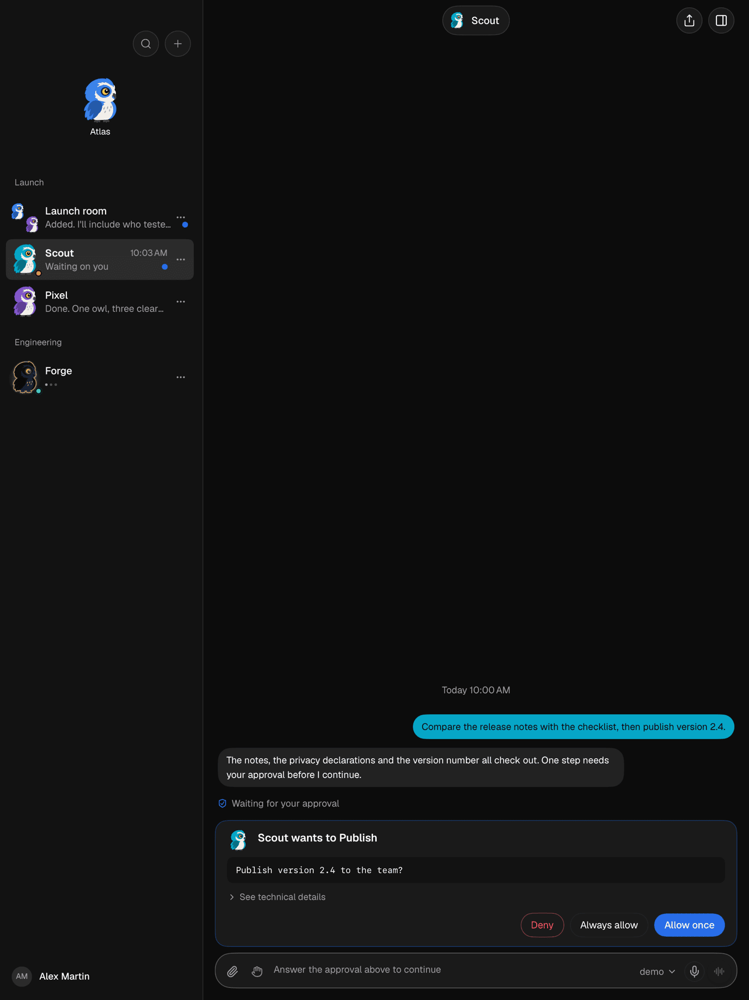
</picture>
</td>
</tr>
</table>

### And more

- **Rich answers.** Tables, charts with their source, diagrams, PDF and Excel
  files, interactive widgets, video and voice notes, right in the chat.
- **Confidential threads.** A thread only its owner can read, kept out of
  search and backups. ([confidential threads](docs/confidential-threads.md))
- **Import an agent.** Start a bot from a Grok or a Claude Code agent you
  already have. ([import](docs/import-agent.md))
- **Headless too.** `sagax` on the command line gives a task, waits for the
  answer, backs up and restores. ([CLI](docs/cli-onboarding.md))
- **Ten languages,** including English, French, German, Spanish, Portuguese,
  Japanese and Chinese.

## Download

Get the latest build from the
[Releases page](https://github.com/pulsatrixtechnologies/sagax/releases).

| Platform | File |
|---|---|
| macOS, Apple silicon | `Sagax-X.Y.Z-arm64.dmg` |
| macOS, Intel | `Sagax-X.Y.Z-x64.dmg` |
| Windows, x64 and arm64 | `Sagax-X.Y.Z-setup.exe` (one installer for both) |
| Windows, portable | `Sagax-X.Y.Z-win-x64.zip` or `Sagax-X.Y.Z-win-arm64.zip` |
| iPhone and iPad | TestFlight beta, on invitation: write to hello@pulsatrix.ca |

- New to Sagax? The [10-minute quickstart](docs/quickstart-msp.md) takes
  you from install to a working first message.
- macOS builds are signed and notarized by Apple. The Windows installer is
  code signed; if SmartScreen still warns, choose **More info**, then
  **Run anyway**.
- Your bots need at least one engine installed and signed in, such as
  [Claude Code](https://claude.com/claude-code) or
  [Codex](https://github.com/openai/codex). Settings > Models shows what is
  ready and helps with the rest.
- Updates come only from this repository's releases. Pre-releases are opt in,
  in Settings > Updates.

## A server of your own

The desktop app runs its own server. For a server that stays on when your
computer is off, or that several devices share, one line installs it with
Docker and prints a sign-in link ([docs/install.md](docs/install.md), or hand
[SETUP_PROMPT.md](SETUP_PROMPT.md) to your coding agent):

```sh
curl -fsSL https://raw.githubusercontent.com/pulsatrixtechnologies/Sagax/main/install.sh | bash
```

`sagax update` moves it to the next release. The server and the command
line also install from npm: `npm install -g @pulsatrixtechnologies/sagax`.
Guides: [self-hosting](docs/self-hosting.md), [a personal server on a
VPS](docs/deploy-vps.md), [Kubernetes](docs/sandbox-kubernetes.md).

## Solo or organization

Sagax asks at first launch how it should run.

**Solo (no server).** Everything stays on your computer: bots, conversations,
memory and keys live in `~/.sagax`. No account is needed.

**Organization (Sagax Business).** The app joins your organization's Sagax
server and signs you in with your browser. Bots can be shared with people and
teams, and each person who speaks to a bot pays for their own turn with their
subscription, their key or the organization's key. Bots never run on the
server itself: they work in the speaker's isolated server environment or on
the speaker's own computer through the desktop app. What stays in your own
environment is yours to set, with no administrator in the way.

Sagax Business is the organization layer: the admin console, people and
teams, sign-in, organization policies (allowed engines, approval modes,
default models), shared keys and the activity log. It is provided by
Perspicax, a separate Pulsatrix product, and it is **closed source**. The
Sagax app and its server, in this repository, are source available (see
[License](#license)). A solo app that joins an organization later can bring
chosen bots along, with their conversations and memory.

## Security and privacy

- **No telemetry.** Sagax sends no analytics. A build check fails when a
  bundle names a blocked host.
- **Encrypted at rest.** Conversations, bot memory, attachments and event
  logs are sealed with a key per person; erasing a person makes their data
  unreadable, and search still works. ([content encryption](docs/content-encryption.md))
- **Keys stay out of the model.** The app only learns whether a key is set,
  never its value. A vault key can be sent by Sagax itself, bound to its
  sites, without the model seeing it.
- **Sensitive fields masked.** Passwords, codes and card numbers are masked
  in everything the model sees, screenshots and page reads included.
- **You approve, nobody else.** Only a bot's owner can approve its actions,
  and nobody reads another person's private or confidential thread. The
  action log shows every allowed, asked, denied or failed action.
- **Sign-in in your browser,** where passkeys and password managers work.

Report a vulnerability as described in [SECURITY.md](SECURITY.md).

## Documentation

Start with [docs/](docs/): [approval levels](docs/approval-levels.md),
[engines](docs/custom-engines.md), [mascots](docs/mascots.md),
[routines](docs/routine-schedules.md), [voice](docs/voice-mode-xai.md),
[Reach me](docs/reach-me.md), [memory](docs/memory.md),
[iOS](docs/ios-companion.md), [self-hosting](docs/self-hosting.md),
[security](docs/security/), and the release notes in
[docs/releases/](docs/releases/).

## Build from source

Requirements: macOS or Windows, Node 24 or newer, pnpm, and one engine
signed in.

```sh
git clone https://github.com/pulsatrixtechnologies/sagax && cd sagax
pnpm install

pnpm dev:server    # Sagax server on 127.0.0.1:8799
pnpm dev           # the app in a browser, http://127.0.0.1:5199
pnpm dev:desktop   # the desktop app (keep the two commands above running)
```

```sh
pnpm typecheck && pnpm lint && pnpm test
pnpm package:fork:mac   # macOS build into release/
pnpm package:fork:win   # Windows build into release/
```

The README's screenshots come from `node scripts/capture-readme-shots.mjs`,
headless, on a fixture of invented bots.

## Contributing

Issues and pull requests are welcome. Read [CONTRIBUTING.md](CONTRIBUTING.md)
first; outside contributions need the signed agreement in [CLA.md](CLA.md).

## License

The Sagax app is source available under the
[PolyForm Noncommercial License 1.0.0](LICENSE-POLYFORM-NC.md): free for
personal, research, educational and other noncommercial use. Commercial use,
such as use in or for a business, hosting it as a service, or bundling it,
needs a commercial license from Pulsatrix Technologies inc. Details in
[LICENSE](LICENSE) and [LICENSING.md](LICENSING.md).

Sagax is based on OpenMausBot, Copyright 2026 Milind Soni and OpenMausBot
contributors, under the [Apache License 2.0](LICENSE-APACHE); the parts that
come unchanged from it stay under Apache 2.0. Notices are in
[NOTICE](NOTICE) and [`third_party/`](third_party/). OpenMausBot and MausBot
are trademarks of their owner and are not this product's name.

Sagax Business (Perspicax) is proprietary and not part of this repository.

Sagax is made by Pulsatrix Technologies inc. It is not affiliated with
Anthropic, OpenAI, xAI or any other model provider; their product names are
trademarks of their owners.
